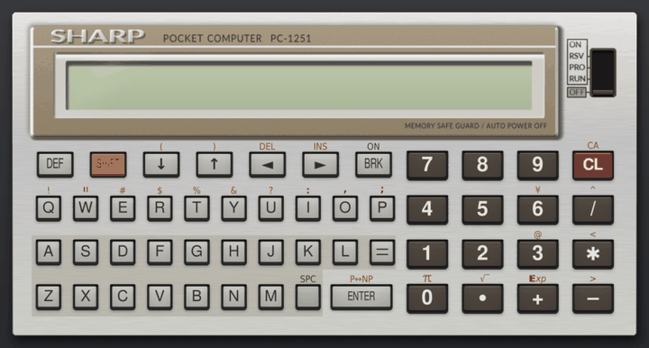
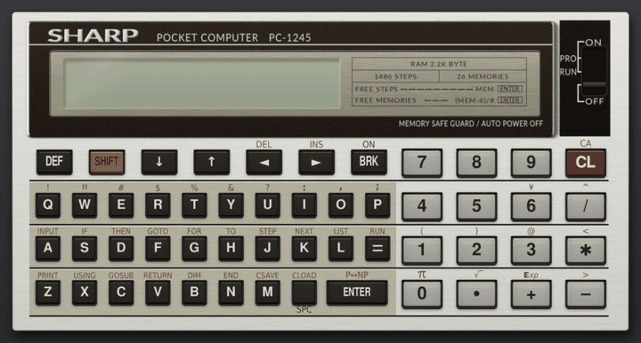

[日本語](README.md) | English


# sc61box: SHARP PC-1251/PC-1245/PC-1261/PC-1350 emulator

sc61box is an emulator of the SC61860, the CPU used in SHARP pocket computers. It runs the internal ROM and BASIC ROM of four models, the PC-1251, the PC-1245, the PC-1261 and the PC-1350, one instruction at a time, so BASIC programs and machine code both work. Even without a ROM you can type in and run machine code (see [Without a ROM](#without-a-rom)). Choose the model with `--model`; the default is the PC-1251.






The user guide, starting from installation on macOS and Windows, is [`doc/manual.pdf`](doc/manual.pdf) (in Japanese).

### If you used it under the old name (pc1251-emulator)

A folder cloned under the old name updates with `git pull`, and the command is now `uv run sc61box`. The data folder `~/.pc1251` is moved to `~/.sc61box` on the first start. Environment variables are now named `SC61BOX_ROM` and so on; the old `PC1251_ROM` and the like are still read.

## Installing

You need [uv](https://docs.astral.sh/uv/). uv fetches a suitable Python by itself.

```sh
git clone https://github.com/woriguchi/sc61box.git
cd sc61box
mkdir rom                            # put the ROM read from a real machine here (see below)
uv run sc61box                 # start
```

### Preparing the ROM

The ROM is Sharp's copyrighted work, so it is not in this repository. Read it out of a real machine and put it in `rom/` under these names. Only the files for the model you use are needed.

| File | Contents | Size |
| --- | --- | --- |
| `cpu-1251.rom` | PC-1251: the SC61860's internal ROM | 8192 bytes |
| `bas-1251.rom` | PC-1251: the BASIC ROM | 16384 bytes |
| `cpu-1245.rom` | PC-1245: the CPU's internal ROM | 8192 bytes |
| `bas-1245.rom` | PC-1245: the BASIC ROM | 16384 bytes |
| `cpu-1260.rom` | PC-1260/1261/1262: the CPU's internal ROM | 8192 bytes |
| `bas-1260.rom` | PC-1260/1261/1262: the BASIC ROM | 32768 bytes |
| `cpu-1350.rom` | PC-1350: the CPU's internal ROM | 8192 bytes |
| `bas-1350.rom` | PC-1350: the BASIC ROM | 32768 bytes |

For example, if you cloned into `~/src`, the files are `~/src/sc61box/rom/cpu-1251.rom` and `~/src/sc61box/rom/bas-1251.rom`.

yagshi's page "[Extracting ROM Data](https://www.oit.ac.jp/rd/labs/kobayashi-lab/~yagshi/old_web/misc/pocketcom/extrom.html)" (in Japanese) describes how to do it on a PC-1251, and "[SHARP PC-1245/50/51/55 の使い方](https://ht-deko.com/pc1245/)" (ht-deko.com, in Japanese) on a PC-1245. To keep the ROM elsewhere, set the environment variable `SC61BOX_ROM` to that folder.

### Without a ROM

The emulator also starts without a ROM (except as a PC-1350) and shows a machine-code workbench to the right of the machine. In the workbench you type in or paste a hex dump, run it, set breakpoints or step one instruction at a time, and watch the registers and memory change. The bundled bouncing ball and Breakout also run without a ROM. `--norom` starts without the ROM even if you have it.

With the ROM, Cmd+D (Ctrl+D) opens the workbench to step through machine code called from BASIC with `CALL`. The workbench is described in the user guide (the section 「マシン語の作業欄」).

## Running

```sh
uv run sc61box --scale 0.8     # smaller window
uv run sc61box primes --run    # load the bundled primes.bas and run it
uv run sc61box ~/prog/game.bas  # load a file by path
uv run sc61box --fresh         # start without the saved RAM
uv run sc61box --norom         # run without the ROM, in the machine-code workbench
uv run sc61box --state ~/.sc61box/state-1251.json  # start from a state saved with Shift+Cmd+S
uv run sc61box --lcd           # show only the LCD, without the calculator picture
uv run sc61box --model 1255    # start as a PC-1255 (1250 also works)
uv run sc61box --model 1245    # start as a PC-1245
uv run sc61box --model 1261    # start as a PC-1261 (1260 and 1262 also work)
uv run sc61box --model 1350    # start as a PC-1350 (--card 16 inserts a 16 KB RAM card)
uv run sc61box --model 1350 --overseas  # PC-1350 wired as the export model (lowercase letters instead of kana)
uv run sc61box --lang en       # English screen (--lang ja for Japanese)
uv run sc61box --help          # list the options
uv run sc61box --version       # print the version (please include it in bug reports)
```

On exit the RAM is saved to `~/.sc61box/ram.bin` (`ram-1245.bin` for the PC-1245, `ram-1261.bin` for the PC-1261, `ram-1350.bin` for the PC-1350) and restored at the next start. Without a ROM it goes to a separate file such as `ram-1251-norom.bin`.

### Display language

The screen text can be English or Japanese. Choose "English" or "日本語" in the "View & Input" menu (remembered for the next start), start with `--lang en` or `--lang ja`, or set the environment variable `SC61BOX_LANG`. Otherwise the system language decides. This README quotes the labels of the English screen.

### Program files

Programs put in `~/.sc61box/programs/` appear in the program list (Cmd+O, or Ctrl+O on Windows). Select a row and press "Load and run" (Enter) or "Load only" (Shift+Enter). You can also drop a file onto the window. If a file cannot be loaded, nothing is written and a message appears at the bottom of the window. "Undo program load" in the "Machine" menu goes back to the state just before loading. `programs/` has samples: primes, a text animation, a display-during-calculation demo, a machine-code dot-by-dot text scroller, a machine-code bouncing ball, breakout, the PC-Interpreter and a mole-bashing game.

Three kinds of file can be loaded. A `.bas` and a `.hex` with the same name form one program: the dump is written first, then the BASIC goes in.

| Kind | Contents | How it is loaded |
| --- | --- | --- |
| `.bas` | BASIC as plain text | after a `NEW` in PRO mode, tokenized and placed in RAM |
| `.hex` | hex dump, one `address data` line after another | written straight into RAM |
| `.bin` | machine-code bytes only | written at the address given by a `# bin:` line in the `.bas` |

A BASIC program typed in the emulator can be exported with Cmd+E (Ctrl+E on Windows) to `~/.sc61box/programs/` as `name-date.bas`. Machine code is not part of the BASIC export; the machine-code workbench exports it to a `.hex` file with "Export .hex", or with "Dump list" (Shift+Cmd+E) as lines of 8 bytes and a checksum (`C000 027F10F800523700:12`). Clicking the range line under these buttons lets you type the range to export; "Automatic" goes back to the range worked out from what you wrote. `uv run sc61box --export folder` exports from the saved RAM.

#### BASIC files (.bas)

A `.bas` file is written into RAM directly, so even long programs load at once.

- On the PC-1251, PC-1250, PC-1255 and PC-1245, write the exponent sign (typed with SHIFT+`+`, a different character from the letter E) as `[E]` or `€`, e.g. `1[E]-8`. The letter `E` or `e` is not an exponent there: `2E-1` means 2×E−1. The PC-1261 (also the PC-1260 and PC-1262) and the PC-1350 have no Exp key, so write exponents with the letter E (`1E-8`); `[E]` and `€` are typed as the letter E too.
- Write π (SHIFT+`0`) as `π`.
- A line longer than 79 characters is loaded if it could be entered on the real machine by recalling the line and appending the rest.

Pasted text (Cmd+V) and dropped text files other than `.bas` and `.hex` are not tokenized but typed key by key at eight times the normal speed. Long lines are not split, so anything past 79 characters is lost.

#### Hex dumps (.hex)

Anything after `;` on a line is a comment. A line may end with `:` and a checksum, the low two hex digits of the sum of its bytes, as in magazine dump listings; a line whose checksum does not match, or is not two hex digits, stops the file from loading. Hex dumps written by the YASM61860 assembler (`c300 : 02 41 37 …`, its `-d` output) can be used as they are.

#### Setting lines

Lines starting with `#` are comments, and can carry these settings.

| Line | Meaning |
| --- | --- |
| `# title: name` | name shown in the list |
| `# run: text` | what to type to run it. Several lines are typed in order, each after the previous command has finished and the ROM is waiting for input again |
| `# mode: PRO` | type the `# run:` text in PRO mode |
| `# help: note` | note shown at the bottom of the window once the program starts. Several lines are stacked |
| `# hex: file` | dump to write first |
| `# bin: file address` | machine-code binary to write first, and its address (`# bin: code.bin &C300`) |
| `# setup: commands` | commands typed in PRO mode after `NEW`, before the BASIC goes in. With this, the dumps are written after `NEW` and these commands |
| `# after: file` | dump to write after the run text is typed. For a `.bin`, add the address: `# after: code.bin &C400` |
| `# norom: note` | note shown when the program is loaded without a ROM. `# norom: off` keeps the program out of the list without a ROM |
| `# data: ranges` | ranges that are data, not code, e.g. `# data: C100-C17F, C200-C20F` (end address included). The workbench disassembly shows them as `DB` rows; ranges you mark as data in the workbench are written here when you export a `.hex` |
| `# model: models` | models it runs on (see [Where to put programs](#where-to-put-programs)) |
| `# ram: range` | extends RAM above the model's RAM to the end of the range, e.g. `# ram: 6800-7FFF` on a PC-1261 (for programs that use RAM the real machine does not have; the range must not overlap ROM or LCD RAM). Loading the program extends RAM, and the extension is saved with the RAM on exit; loading a program without `# ram:` restores the model's RAM |
| `# pad: mapping` | gamepad mapping (see [Gamepad](#gamepad)), as pairs of gamepad input and pocket computer key separated by spaces: `# pad: dpup=8 dpdown=2 dpleft=4 dpright=6 a=SPC` |

- Addresses can be written as `&C300`, `0xC300` or `C300`.
- `# setup:` is for programs that move the BASIC area with `EQU#` and put machine code in the space freed.
- `# after:` is for programs where the BASIC reserves space with `DIM` before the machine code is written.
- A `.hex` that is only used through `# hex:` or `# after:` (with no `.bas` of the same name) is not listed on its own; its size is shown on the program that uses it.

#### Where to put programs

| Runs on | Where |
| --- | --- |
| one model | that model's folder inside the program folder (`pc1251/`, `pc1245/`, `pc1261/`, `pc1350/`) |
| several models | directly in the program folder, with a line such as `# model: 1251,1245` |
| every model (BASIC) | directly in the program folder, without `# model:` |

- Programs in `pc1251/` also appear on the PC-1250 and PC-1255, and those in `pc1261/` on the PC-1260 and PC-1262, if their machine code fits in RAM and does not overlap the BASIC area.
- A program for another model is not listed.
- A program written separately for each model can sit under the same `# title:` in each model's folder.

### Assembler

`tools/asm61860.py` assembles SC61860 source (`.asm`) into a `.hex` file this emulator can load. Run it in the emulator folder:

```sh
uv run python tools/asm61860.py vline.asm vline.hex
uv run python tools/asm61860.py sprite.asm sprite.hex -D MASK=1   # give a value to a name used in IF
uv run python tools/asm61860.py add.asm add.hex --rom 1251        # use names of ROM routines (FADD, KEYSCAN, ...)
```

One instruction per line; `label:`, `; comment`, `ORG`, `EQU`, `DB` and `IF`/`ELSE`/`ENDIF` are available. Numbers are decimal; write hexadecimal as `&C000` or `0xC000`. `JR`, `JRZ`, `JRNZ`, `JRC` and `JRNC` pick the forward or backward form (`JRP`, `JRM` and so on) from the target. `lo()` and `hi()` take the low and high byte of a 16-bit value. The full syntax is described at the top of the file. Put the `.hex` together with a `.bas` of the same name in `~/.sc61box/programs/` to run it from the program list.

### Keys

Click the keys on screen with the mouse. Letters, digits, symbols, Enter, Space and the arrow keys on your own keyboard work as well.

| macOS | Windows | Machine |
| --- | --- | --- |
| Tab | Tab | SHIFT |
| Option | Alt | DEF |
| delete | Backspace | delete one character |
| fn+delete | Delete | CL |
| Esc | Esc | BRK (ON while the power is off) |
| `\` | `\` | ¥ |
| Cmd+↑, Cmd+↓ | Ctrl+↑, Ctrl+↓ | move the mode switch up or down one step |
| Cmd+O | Ctrl+O | program list |
| Cmd+R | Ctrl+R | the RESET button on the back |
| Cmd+T, Shift+Cmd+T | Ctrl+T, Shift+Ctrl+T | faster / slower (½×, 1×, 2×, 4×, 8×; away from 1× the pitch of the sound changes too) |
| Cmd+E | Ctrl+E | export the BASIC program in memory to a .bas file (while keys go to the workbench, export its dump to a .hex file) |
| Shift+Cmd+E | Shift+Ctrl+E | while keys go to the workbench, export its dump as a dump list (8 bytes:checksum per line) |
| Cmd+S | Ctrl+S | save a screenshot |
| Shift+Cmd+S | Shift+Ctrl+S | save the state (save anywhere) |
| Shift+Cmd+L | Shift+Ctrl+L | go back to the saved state |
| Shift+Cmd+R | Shift+Ctrl+R | start recording / stop and save the video |
| Shift+Cmd+P | Shift+Ctrl+P | pause / resume recording |
| Cmd+P | Ctrl+P | pause / resume execution (separate from pausing the recording) |
| Cmd+/ | Ctrl+/ | key help |
| Cmd+V | Ctrl+V | type the clipboard text in (while keys go to the workbench, paste a dump into it) |
| Cmd+K | Ctrl+K | make the arrow keys press 8, 2, 4, 6 on the keypad, or back |
| Cmd+D | Ctrl+D | show or hide the machine-code workbench (with a ROM) |
| Cmd+Z | Ctrl+Z | undo a write in the workbench (Shift+Cmd+Z redoes it) |
| Cmd+A | Ctrl+A | make the workbench cursor address the start address |

The "● Record" button at the right end of the bar or Shift+Cmd+R (Shift+Ctrl+R on Windows) starts and stops recording; Shift+Cmd+P pauses it. Stopping saves a 1280×720 MP4 video with sound, showing an enlarged LCD above the whole calculator, as `rec-<date>-<time>.mp4` in the program folder. On platforms other than Windows, macOS and Linux (x86_64 and aarch64), recording needs an ffmpeg on the PATH.

Shift+Cmd+S (Shift+Ctrl+S on Windows) saves the whole machine state to `~/.sc61box/state-<model>.json` (one per model), and Shift+Cmd+L goes back to it. Start with `--state file` to begin from a saved state. Saving again keeps the previous state with `.bak` added.

Below the calculator is a bar. The buttons "Programs", "Machine" and "View & Input" open short menus with the actions in the table above and more; "Pause" pauses execution and "Speed" picks the speed. Hovering over a button shows what it does and its shortcut. Turn off Japanese input before typing.

In the program list, type `/` and part of a name to show only the programs that match.

On a PC without a numeric keypad, games that use 8, 2, 4 and 6 (up, down, left and right around 5) are easier with Cmd+K (Ctrl+K on Windows, or F7): the arrow keys then press those number keys. Press it again to switch back, or start with `--numpad`.

"LCD only" in the "View & Input" menu hides the calculator picture and shows just the LCD across the window. The window can then be resized, so maximizing it fills the screen with the LCD. Type on your keyboard or use a gamepad. To go back, press the "Calculator" button in the bar. Start with `--lcd` to begin in this mode.

### Gamepad

A gamepad connected to the OS (Bluetooth or USB) can press the pocket computer's keys. Any gamepad in SDL's GameController database works (8BitDo, Xbox, PlayStation and Nintendo Switch controllers and so on). Pair it in the OS settings first. The D-pad, A, B, X, Y, L, R, ZL, ZR, Select, Start, the stick buttons and Home each map to one pocket computer key. The left and right sticks act as the D-pad directions, and unmapped inputs do nothing. The initial mapping is D-pad to 8, 2, 4, 6, A to SPACE, B to 0, Start to ENTER and Select to BRK.

#### Changing the mapping

"Gamepad mapping…" in the "View & Input" menu adds a mapping panel below the calculator picture, and the keys of the calculator picture carry tags with the inputs mapped to them (A, ←, …).

1. Press a gamepad button or click a mapping in the panel to select an input.
2. Click a key on the calculator picture to map it to the selected input. Keys typed without SHIFT can also be mapped by pressing them on your keyboard.

- Delete or Backspace (fn+delete or delete on macOS) clears the mapping of the selected input.
- Esc while an input is selected cancels the selection; Esc with no input selected closes the panel.
- While the panel is open, gamepad input is not sent to the pocket computer.
- Button names follow the SDL convention for the A/B/X/Y positions and may differ from the labels printed on your pad. If they differ, press the button you want to map.

#### Saving the mapping

Mappings can be kept per program. The buttons of the panel save and restore them.

| Button | What it does |
| --- | --- |
| Save for this program | writes the current mapping to `pads/programs/<program>.json` in the program folder (`pads/programs/pc1350/<program>.json` for a program in a model folder); it takes precedence over the file's `# pad:` the next time that program is loaded |
| Save as default | writes `pads/default.json`, used at startup and for programs without `# pad:` |
| Reset to factory mapping | returns to the initial mapping above |
| Back to # pad: | returns to the loaded program's `# pad:` |
| Copy # pad: line | puts the current mapping on the clipboard as a `# pad:` line (see below) |

Delete the file to drop a saved mapping.

#### Writing the mapping in a program file

A program file may contain a line such as `# pad: dpup=8 dpdown=2 dpleft=4 dpright=6 a=SPC`, and loading the program applies that mapping. Only the inputs written are mapped; the others do nothing.

- Write `input=key` pairs separated by spaces. The mapping may be split over several `# pad:` lines.
- The input names are `dpup`, `dpdown`, `dpleft`, `dpright`, `a`, `b`, `x`, `y`, `leftshoulder`, `rightshoulder`, `lefttrigger`, `righttrigger`, `back`, `start`, `leftstick`, `rightstick` and `guide`.
- The key names are those of the current model's keys: `SPC`, `ENTER`, `UP`, `DOWN`, `LEFT`, `RIGHT`, `SHIFT`, `DEF`, `BRK`, letters, digits and symbols, plus `CL` on models other than the PC-1350 and `CLS`, `MODE`, `KANA`, `INS` and `DEL` on the PC-1350. A `,` is not a separator; it can be written as the name of the PC-1350's `,` key (`a=,`).

### Breakout

`programs/pc1251/break.hex` and `break.bas` are a sideways breakout game written in machine code. Move the paddle with ↑ and ↓, serve with Space, and knock bricks out of the wall creeping in from the right. At the start choose 1 (EASY, three-dot paddle) or 2 (NORMAL, two-dot paddle). Each level has one blinking brick; breaking it releases a second ball, and losing one of the two does not cost a life. With a gamepad, move the paddle with ↑ and ↓ on the D-pad and serve with A; at the start, choose 1 with X or 2 with Y and press ENTER with Start (the `# pad:` line in `break.bas`).

The PC-1245 version is `break.hex` and `break.bas` in `programs/pc1245/`; the list shows one "breakout" entry for whichever model is running. On the PC-1245 the playing field is 75 columns, the score is shown only after the game, and there is no blinking brick (there is not enough memory for it).

### PC-Interpreter and "Reading the PC-Interpreter"

The "PC-Interpreter" from the August 1986 issue of the Japanese magazine PiO (by [Fan_PC-1251](https://x.com/pio1986_10)) runs as well. `programs/pcint.hex` is the article's listing 1 and `programs/mogura.bas` is listing 2, a mole-bashing game; both are included with the author's permission.

Start the game from the program list, then hold down the number key (1–6) of the hole the mole pops out of.

[`doc/pcinterp.pdf`](doc/pcinterp.pdf) is "PC-インタープリタを読む" (Reading the PC-Interpreter, by origuchi), a booklet in Japanese that reads the program instruction by instruction.

### Printer

A printer (a thermal printer that prints 5×7 dot characters) is always connected. When a program prints with `LPRINT` or `LLIST`, a strip of paper comes out below the calculator and the lines come out one by one at the speed of the real printer (about a second a line), scaled by the speed setting (Cmd+T). When four or more lines are waiting, as after `LLIST` of a long program, they come out faster and are all out in about two and a half seconds. The paper-feed sound is synthesized to resemble a CE-126P; `--mute` silences it. Pressing SHIFT+ENTER (P↔NP) also prints calculations typed by hand; the PC-1251 and PC-1245 show P on the LCD and the PC-1261 shows PRINT, while the PC-1350 has no symbol for it (as on the real machine).

- Scroll with the mouse wheel over the paper to see earlier lines.
- The printout is saved automatically as a picture of the paper in the program folder as `print-<date>-<time>.png`. Click the location shown to the left of the paper to open the folder.
- The × to the right of the paper, or "Put the paper away" in the "View & Input" menu, puts the paper away. That ends the sheet; the next printout starts a new sheet and a new file.
- The printer has its own character set with a character for every code from 00 to FF. BASIC can print only some of them; the rest print when machine code sends the codes to the printer.

### Cassette audio (wav)

Programs can be exchanged with a real machine as cassette audio (wav files).

- **Emulator to real machine**: type `CSAVE` or `CSAVE M` in RUN mode. The sound the ROM sends to the cassette port is written to the program folder (`~/.sc61box/programs`) as `tape-<date>-<time>.wav`. Play the wav into the real machine's cassette interface and type `CLOAD`/`CLOAD M` on the real machine. `BEEP` sounds are not written.
- **Real machine to emulator**: record the real machine's `CSAVE` as a wav, drop it onto the window (or start with `--tape file`) to insert it as a tape, then load it with `CLOAD`/`CLOAD M`.

Machine-code wavs made with PocketTools' `bin2wav` or YASM61860's `-w` (with `-old`) load with `CLOAD M`.

## Running as a PC-1250 or PC-1255

`--model 1250` and `--model 1255` start the emulator as a PC-1250 or PC-1255. Both use the same ROM as the PC-1251 and differ only in RAM size, so they run the PC-1251's `cpu-1251.rom` and `bas-1251.rom`.

| Model | RAM | Free for programs (`MEM`) |
| --- | --- | --- |
| PC-1250 | 2 KB | 1438 bytes |
| PC-1251 | 4 KB | 3486 bytes |
| PC-1255 | 10 KB | 9630 bytes |

The program list shows the PC-1251 programs that fit in RAM. The PC-1250's RAM is small, so Breakout and some others are not listed. RAM is saved to `~/.sc61box/ram-1250.bin` and `ram-1255.bin`.

## Running as a PC-1245

With `--model 1245` the emulator starts as a PC-1245, which uses a ROM different from the PC-1251's. Put its ROM in `rom/` as `cpu-1245.rom` and `bas-1245.rom` (see [Preparing the ROM](#preparing-the-rom)).

```sh
uv run sc61box --model 1245
uv run sc61box --model 1245 primes --run
```

The program list, exporting, shortcuts and running programs with DEF work as on the PC-1251. The differences are:

- The LCD has 16 characters. Anything written to the right of the 16th is not visible, so some PC-1251 programs show only part of their display.
- The breakout sample loads its PC-1245 version (`programs/pc1245/`): a 75-column playing field, the score shown only after the game, and no blinking brick.
- RAM is 2 KB, and 1486 bytes are free for programs (the value of `MEM`).
- The mode switch has three positions, PRO, RUN and OFF; there is no RSV.
- On the A–= and Z–SPC rows, SHIFT followed by a key enters the BASIC keyword printed above it (INPUT, IF, THEN, …, PRINT, USING, …, CLOAD).
- Parentheses are SHIFT+1 and SHIFT+2. Typing `(` or `)` on the PC keyboard is translated into these.
- RAM is saved to `~/.sc61box/ram-1245.bin` on exit, separately from the PC-1251's `ram.bin`.

Apart from DEG, the positions of the LCD annunciators are estimates.

## Running as a PC-1261

With `--model 1261` the emulator starts as a PC-1261, a model with a two-line, 24-column LCD and a ROM different from the PC-1251's. Put its ROM in `rom/` as `cpu-1260.rom` and `bas-1260.rom` (see [Preparing the ROM](#preparing-the-rom)). The PC-1260 and PC-1262 use the same ROM and differ only in RAM size, so `--model 1260` and `--model 1262` use the same files.

```sh
uv run sc61box --model 1261
uv run sc61box --model 1261 ball --run  # the bouncing ball sample
uv run sc61box --model 1261 hello --run  # load and run the sample hello.bas
uv run sc61box --model 1261 lc3-block --run  # compile a breakout game with the LC-3 compiler and play
```

The program list, export, shortcuts, DEF-key execution and cassette audio work as on the PC-1251. The differences:

- The LCD has two lines of 24 characters. Short bars light above the labels BUSY, PRINT, DEG, RAD and ERROR, and カナ (kana), SMALL, SHIFT and DEF sit at the left edge of the LCD. After `POKE &203C,PEEK &203C AND &7F` in RUN mode, SHIFT+8 toggles lowercase (SMALL) instead of katakana.
- The parentheses are SHIFT+1 and SHIFT+2, and ¥ is SHIFT+6. There is no Exp key, so write exponents with the letter E (`1E3`). Typing `(`, `)` or `¥` on the PC is converted to those key strokes.
- SHIFT+8 (カナ) switches to katakana input. Each key then enters the kana printed at its lower right, and with SHIFT the one at its upper right; keys marked with a dot give small kana (ァ, ッ and so on) with SHIFT. Kana typed or pasted on the PC (full-width, half-width or hiragana) are entered by switching to kana input and back afterwards; voiced marks become ゛ (SHIFT+−) and ゜ (SHIFT++) after the kana.
- RAM is 10 KB, with 9342 bytes free (`MEM`). The PC-1260 has 4 KB with 3198 bytes free.
- Pasted text is typed at about 0.22 seconds per key stroke.
- PC-1261 samples are in `programs/pc1261/` (the PC-1260 has too little RAM for LC-3 and its samples). `ball` is machine code in which a ball bounces across both LCD lines while moving right.
- The LC-3 compiler (by COR, Pocket Computer Journal, June 1989) is included as `programs/pc1261/lc3.hex`. It compiles a game-oriented language with one-byte integers, whose source is typed in as a BASIC program, into machine code. Choosing "LC-3コンパイラ" in the list writes the compiler and moves the BASIC area out of its way. Then type the source in PRO mode, compile it with `CALL &4000` and run it with `CALL &4900`. Three samples from the article (`lc3-hello`, `lc3-move`, `lc3-chars`) and a breakout game (`lc3-block`, paddle on 8 and 2) compile and run as soon as they are chosen. The compiler is `LC-3.bin` from [hiroog/LC3_Compiler](https://github.com/hiroog/LC3_Compiler) (see [Rights](#rights)).
- RAM is saved to `~/.sc61box/ram-1261.bin` (`ram-1260.bin`, `ram-1262.bin`).

## Running as a PC-1350

With `--model 1350` the emulator starts as a PC-1350, a model with a 150×32 dot LCD (4 lines of 24 characters). Put its ROM in `rom/` as `cpu-1350.rom` and `bas-1350.rom` (see [Preparing the ROM](#preparing-the-rom)). It was tested with the Japanese ROM, which can type katakana.

```sh
uv run sc61box --model 1350
uv run sc61box --model 1350 --card 16  # start with a 16 KB RAM card (CE-202M)
uv run sc61box --model 1350 hello --run  # load and run the sample hello.bas
uv run sc61box --model 1350 ball --run  # the bouncing ball sample
```

The program list, export, shortcuts, DEF keys and cassette audio (wav) work as on the PC-1251. The differences are:

- There is no mode switch. RUN and PRO are toggled with the MODE key. F1 selects RUN mode and F2 PRO mode (pressing MODE if the current mode differs). The switch at the top right is the power switch; move it with the mouse or with F3 (ON) and F4 (OFF). Programs survive switching off. The ON key (BRK) does not switch on while the switch is OFF.
- The annunciators RUN, PRO, カナ, SML, SHIFT and DEF are arranged vertically at the left edge of the LCD.
- The keys follow the PC-1350 layout. Parentheses, `/`, `:`, `;` and `,` are on the numeric side and need no SHIFT; `<`, `>`, `¥` and `^` are SHIFT plus a numeric-side key. Symbols typed on the computer are converted to these key sequences. There is no Exp key, so write exponents with the letter E (`1E3`). Delete is DEL, Insert is INS, Home is CLS, and Backspace deletes one character with ◀ and DEL.
- The カナ key (F8 on the computer) switches to katakana input and SHIFT+カナ to lower-case input (SML). Katakana typed or pasted on the computer (full-width, half-width or hiragana) is typed in katakana input, switching back afterwards. In program files, lower-case letters inside `"` strings are typed as they are, switching to SML; everything else is upper-cased (keywords must be upper case).
- RAM is the built-in 4 KB, leaving 3070 bytes for programs (the value of `MEM`). `--card 8` and `--card 16` insert an 8 KB or 16 KB RAM card, leaving 11262 or 19454 bytes.
- Pasted text is typed at about 0.25 s per keystroke.
- PC-1350 samples are in `programs/pc1350/`. `ball` is machine code in which a ball bounces between the bottom and the top of the LCD while moving right.
- RAM is saved to `~/.sc61box/ram-1350.bin` (with a card, a name including its size such as `ram-1350-16k.bin`).


## Differences from the real machine

- Cassette input has been checked with recordings of real tapes (they load with `CLOAD`). The wavs the emulator writes have not been played into a real machine yet.
- The printer's paper feed key is not reproduced.
- The printer takes each byte at once, so programs do not wait for printing.
- Different ROM versions have not been checked.
- BASIC's `PEEK` can read the internal ROM here (according to the documentation, on the real machine only the `DATA` instruction can read it).

The memory map, I/O ports and LCD RAM layout are summarized in an appendix of the manual ([`doc/manual.pdf`](doc/manual.pdf), in Japanese).

## Development

This emulator was made with the help of Anthropic's Claude.

## Acknowledgements

This emulator was written with reference to the following emulators. Many thanks to their authors.

- [MAME](https://github.com/mamedev/mame)
- [PockEmul](https://github.com/paulie-g/PockEmul)
- [PokecomGO](https://github.com/digihori/pokecom)
- [Pokecom GO Plus](https://github.com/digihori/pokecom-go-plus)

## Rights

The emulator's code and artwork are released under the MIT License ([LICENSE](LICENSE)). `lc3.hex` (the LC-3 compiler) and the article sources among the `lc3-` samples in `programs/pc1261/` (`lc3-hello`, `lc3-move`, `lc3-chars`) are works by LC-3's author COR (hiroog on GitHub) and are not covered by the MIT License. They are included under the author's statement in his [blog post of 3 January 2018](https://wlog.flatlib.jp/archive/1/2018-1-3) that LC-3 may be distributed freely and that dump lists, binaries and the like may be published as anyone likes.

SHARP is a trademark of Sharp Corporation. This is an unofficial emulator made by an individual and has no connection with Sharp Corporation.
